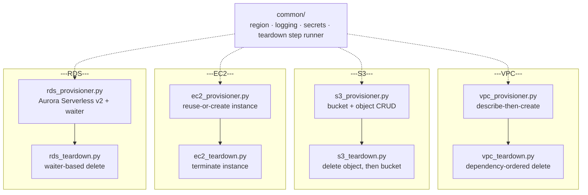

# aws-python-boto3-automation

> Idempotent AWS infrastructure automation in Python/boto3: describe-then-create VPC provisioning with dependency-ordered teardown + S3/EC2 lifecycle scripts with ClientError handling and logging + Aurora/RDS domain using boto3 waiters for async operations

A collection of Python/boto3 scripts that provision and tear down AWS infrastructure using a describe-then-create pattern. The repository consolidates earlier exploratory scripts into four self-contained domains:

- **`vpc/`**: idempotent provisioning of a VPC, internet gateway, route table, and three availability-zone-spanning subnets, with a paired teardown script that removes everything in dependency order.
- **`s3/`**: idempotent provisioning of an S3 bucket and object (create-or-reuse, upload, read, update) with `ClientError` handling and logging, with a paired teardown script that deletes the object then the bucket.
- **`ec2/`**: idempotent provisioning of an EC2 instance (reuse-or-create) with `ClientError` handling and logging, with a paired teardown script that terminates it.
- **`rds/`**: built to the same engineering standard as the other three (functions, error handling, logging, no hardcoded secrets), including correct use of a boto3 waiter instead of manual polling.

A `legacy/` directory preserves the original, pre-refactor versions of the EC2, VPC and S3 scripts for comparison.

## Architecture



Every domain follows the same shape: a provisioner that checks before creating, and a paired teardown that reverses it. `common/` is the one place region resolution, logging, secret handling, and the not-found/halt teardown logic live, so all eight scripts behave identically instead of six-plus slightly different copies. The `rds/` domain is built to the same standard as the other three (see [RDS/Aurora (Bonus Domain)](#rdsaurora-bonus-domain)).

## Requirements

- **Python 3.10 or later.** The codebase relies on modern type-hint syntax (e.g. `str | None`, bare `list[str]`), and the pinned `boto3` version below requires Python 3.10+ as well.
- **boto3 `1.43.48`** and **botocore `1.43.48`** (pinned exactly in `requirements.txt`).

## Installation

Install the runtime dependencies with:

```bash
pip install -r requirements.txt
```

This installs the two pinned packages (`boto3`, `botocore`) listed in `requirements.txt` and nothing else is required to run any of the domain scripts.

If you also want to run the test suite, install the additional pinned test dependencies (`pytest`, `hypothesis`, `moto`):

```bash
pip install -r requirements-dev.txt
```

`requirements-dev.txt` is only needed for testing, none of the scripts under `vpc/`, `s3/`, `ec2/`, or `rds/` import anything from it.

## AWS Credentials

This project never embeds AWS credentials in source code. All credentials and the default region are resolved exclusively through boto3's standard credential provider chain, so no script accepts a key, secret, or token as a literal, a command-line argument, or any other out-of-band mechanism.

boto3's provider chain checks, in order, sources such as:

- Environment variables: `AWS_ACCESS_KEY_ID` and `AWS_SECRET_ACCESS_KEY` (plus optionally `AWS_SESSION_TOKEN`)
- The shared credentials and config files: `~/.aws/credentials` and `~/.aws/config`
- An IAM role attached to the compute environment the script runs on (EC2 instance profile, ECS task role, Lambda execution role, etc.)
- AWS IAM Identity Center / SSO (`aws sso login`, then a profile referencing that SSO session)

To set up credentials for local use:

**macOS / Linux (bash/zsh):**
```bash
export AWS_ACCESS_KEY_ID="your-access-key-id"
export AWS_SECRET_ACCESS_KEY="your-secret-access-key"
```

**Windows (PowerShell):**
```powershell
$env:AWS_ACCESS_KEY_ID="your-access-key-id"
$env:AWS_SECRET_ACCESS_KEY="your-secret-access-key"
```

(Or, if you have the AWS CLI installed, run `aws configure` instead, which prompts for the same values and writes them to `~/.aws/credentials` (`%USERPROFILE%\.aws\credentials` on Windows) for boto3 to pick up automatically.)

Whichever method you use, verify it works with any AWS CLI command (e.g. `aws sts get-caller-identity`) before running the domain scripts.

## Region Configuration

Every domain script resolves its AWS region through `common.config.resolve_region()`, so region configuration is identical across all eight scripts (`vpc_provisioner.py`, `vpc_teardown.py`, `s3_provisioner.py`, `s3_teardown.py`, `ec2_provisioner.py`, `ec2_teardown.py`, `rds_provisioner.py`, `rds_teardown.py`) rather than being configured per-domain.

**Default region:** `ap-southeast-2`. If no override is set, every domain script uses this region.

**Override mechanism:** the `PORTFOLIO_AWS_REGION` environment variable. Set it before running a script and that script uses the given value instead of the default for every region-scoped AWS call it makes during that invocation. This is deliberately a project-specific variable, not boto3's own `AWS_DEFAULT_REGION`, so it can't collide with the separate region resolution boto3's credential provider chain already does.

**Invalid values fail fast:** if `PORTFOLIO_AWS_REGION` is set to a value that isn't a recognized AWS region (checked against boto3's locally bundled EC2 region list, no network call involved), the script raises an error and exits before constructing any boto3 client, no AWS API call is attempted with an invalid region.

**Example: overriding the default region for a domain script**

**macOS / Linux (bash/zsh):**
```bash
export PORTFOLIO_AWS_REGION=us-west-2
python -m vpc.vpc_provisioner
```

**Windows (PowerShell):**
```powershell
$env:PORTFOLIO_AWS_REGION="us-west-2"
python -m vpc.vpc_provisioner
```

Run from the project root (so `vpc` resolves as a package). This provisions the VPC domain's resources in `us-west-2` instead of the default `ap-southeast-2`. The same pattern applies to any other domain script, e.g. `python -m s3.s3_provisioner` or `python -m rds.rds_provisioner`. Set `PORTFOLIO_AWS_REGION` first, then invoke the script as a module from the project root.

## Running the Scripts

All eight domain scripts are invoked as Python modules from the project root, so that each domain's package (`vpc`, `s3`, `ec2`, `rds`) resolves correctly. Activate the project's virtual environment first:

**macOS / Linux (bash/zsh):**
```bash
source .venv/bin/activate
```

**Windows (PowerShell):**
```powershell
.venv\Scripts\Activate.ps1

(If Powershell blocks the script with an execution-policy error, run `Set-ExecutionPolicy -Scope CurrentUser -ExecutionPolicy RemoteSigned` once, then retry.)

Once activated, your shell prompt will show `(.venv)` and plain `python` commands below will use the virtual environment automatically on either OS.

### VPC

```bash
python -m vpc.vpc_provisioner
```

Idempotently creates (or reuses) the VPC, internet gateway, route table, and three AZ-spanning subnets.

```bash
python -m vpc.vpc_teardown
```

Removes everything the VPC provisioner created, in dependency order (subnets → route tables → internet gateway → VPC).

### S3

```bash
python -m s3.s3_provisioner
```

Idempotently creates (or reuses) the bucket, then uploads an object, reads it back, updates it, and reads it back again. The bucket and object are left in place for inspection.

```bash
python -m s3.s3_teardown
```

Deletes the object, then the bucket, in that order (S3 requires a bucket be empty before it can be deleted).

### EC2

```bash
python -m ec2.ec2_provisioner
```

Acquires an instance (reuses a matching pending/running/stopping/stopped instance, or creates a new one) and leaves it running for inspection.

```bash
python -m ec2.ec2_teardown
```

Looks up that same instance by its `Name` tag and terminates it.

### RDS

The RDS provisioner requires the `RDS_MASTER_PASSWORD` environment variable to be set before it runs, it fails fast with a clear error if that variable is missing or empty, before making any AWS call:

**macOS / Linux (bash/zsh):**
```bash
export RDS_MASTER_PASSWORD=<a-password-you-choose>
python -m rds.rds_provisioner
```

**Windows (PowerShell):**
```powershell
$env:RDS_MASTER_PASSWORD="<a-password-you-choose>"
python -m rds.rds_provisioner
```

Creates the RDS domain's own VPC/subnets, a DB subnet group, and an Aurora Serverless v2 cluster and instance, waiting on a boto3 waiter for the cluster to become available.

```bash
python -m rds.rds_teardown
```

Deletes the DB instance, then the DB cluster, then the DB subnet group, then the subnets and VPC, in that order, using boto3 waiters to confirm each deletion before proceeding to the next.

## About This Project

Think of this repository as a toolkit, not a one-shot script collection. Each domain (`vpc/`, `s3/`, `ec2/`, `rds/`) is an idempotent provisioning/teardown pair aimed at a disposable AWS lab environment: you stand resources up, use them for whatever you're learning or demoing, then tear them back down, and you can repeat that cycle as many times as you like without manual console cleanup or state drift creeping in between runs. The describe-then-create pattern is what makes "run it again" safe, a second run finds what's already there instead of creating a duplicate.

That framing comes with a deliberate boundary: this is built for throwaway learning and demo environments, not production infrastructure. There's no state locking, no change review, no rollback beyond what dependency-ordered teardown gives you, and (per the Limitations section below) a couple of the domains intentionally favor a simple, repeatable demo cycle over strict idempotence. Each domain is also self-contained, tearing down one domain's resources doesn't touch another's, so you can bring up just the piece you're working with.

## Legacy Scripts

The `legacy/` directory holds the two original, pre-refactor scripts this project started from, kept as "before" artifacts so the refactor is visible rather than asserted:

| Legacy script | Refactored counterpart |
|---|---|
| `legacy/boto3-vpc.py` | `vpc/vpc_provisioner.py` + `vpc/vpc_teardown.py` |
| `legacy/boto3-ec2.py` | `ec2/ec2_provisioner.py` + `ec2/ec2_teardown.py` |
| `legacy/boto3-s3.py` | `s3/s3_provisioner.py` + `s3/s3_teardown.py` |

**VPC:** `legacy/boto3-vpc.py` tags the VPC in a separate `create_tags` call made *after* `create_vpc`, with a `time.sleep(5)` in between to wait out tag-propagation lag, and leaves ambiguous-match and creation-failure cases unhandled entirely. There's no `except` anywhere in the file. `vpc/vpc_provisioner.py` applies the `Name` tag via `TagSpecifications` at creation time instead, so there's no sleep to get right, and each resource type's describe-then-create logic lives in its own `ensure_*` function (`ensure_vpc`, `ensure_igw`, `ensure_route_table`, `ensure_subnet`, `ensure_association`) that raises `AmbiguousResourceError` on 2+ matches or `ResourceCreationError` on a failed create, instead of letting either case pass through silently or crash with a raw traceback.

**S3:** `legacy/boto3-s3.py` writes upload content to local temp files and has a latent bug where the "update" step opens a hardcoded `"file_2.txt"` relative path with `open(...)` instead of the `file_path` variable it just built two lines above, which means the update only works if the script happens to be run from its own directory. It also has no `try/except` around any S3 call, and combines provisioning and full deletion into a single, always-delete run. `s3/s3_provisioner.py` builds both the initial and updated object content directly as in-memory `bytes` and writes them via `Object.put(Body=...)`, so there's no local file and no path bug to have; every bucket/object operation (`ensure_bucket`, `upload_object`, `read_object`) is wrapped in its own `try/except ClientError` that logs via Python's `logging` module rather than `print()`; and provisioning is split from deletion into a paired `s3/s3_teardown.py` script, so a run converges on the object's final content instead of always ending in delete.

## RDS/Aurora (Bonus Domain)

The `rds/` domain is built to the same engineering standard as `vpc/`, `s3/`, and `ec2/`: every step (VPC/subnet lookup-or-create, DB subnet group creation, DB cluster and instance creation) is organized into a function following the describe-then-create pattern, every AWS call is guarded by `ClientError` handling, status and errors go through the `logging` module instead of `print()`, and the database master password is read from the `RDS_MASTER_PASSWORD` environment variable rather than hardcoded, with the script failing fast if that variable is unset, before any AWS call is made. It also goes a step further than manual polling: cluster creation waits on boto3's `db_cluster_available` waiter instead of a `time.sleep()` loop, mirroring the wait-then-proceed pattern `rds/rds_teardown.py` already uses for deletion.

## Limitations

This section is the honest counterweight to the "idempotent toolkit" framing above. It names exactly where that framing doesn't fully hold, rather than letting the narrative overstate what the code does.

### EC2 and S3 defaults are one account's examples, not universal values

The default AMI id and key pair name in `ec2/ec2_provisioner.py` are one account/region's specific examples, carried over from the original script. They are not guaranteed to be valid in a different AWS account or region. Override them with the `EC2_AMI_ID` and `EC2_KEY_PAIR_NAME` environment variables before running the script against your own account, otherwise `run_instances` will fail with a `ClientError` (logged, not raised) if the default AMI id doesn't exist in your account.

Separately, `s3/s3_provisioner.py`'s `BUCKET_NAME` is a fixed constant rather than an environment-variable override. S3 bucket names are globally unique across every AWS account, not just your own, so bucket creation will fail with a `ClientError` (logged, not raised) if another AWS account has already claimed that exact name. If that happens, edit `BUCKET_NAME` in `s3/s3_provisioner.py` (and `s3/s3_teardown.py`, which imports it from there) to something more unique.
